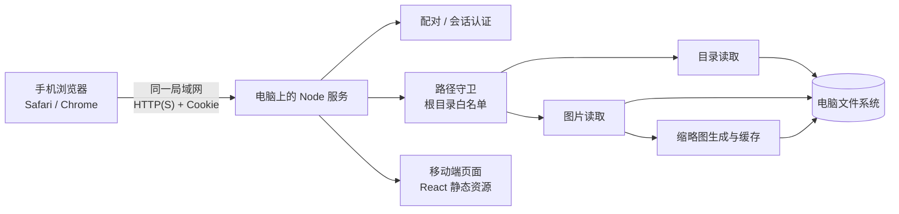
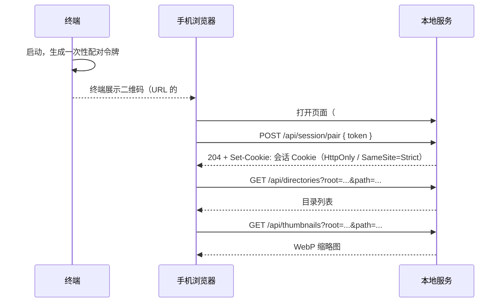

# 手机浏览电脑文件夹与图片 · 功能方案

> 状态：**草案 v0.1，待评审**
> 日期：2026-11-21
> 需求：在手机上浏览电脑上的文件夹和图片；只做浏览，不做其他功能；先提交方案 PR 评审。
> 本 PR 仅包含本文档，不含实现代码。

## 0. 评审摘要

一句话：在电脑上运行一个**只读**的小型 Web 服务，手机连同一个 Wi-Fi 后扫码打开网页，即可浏览指定文件夹、查看图片；不提供上传、删除、重命名、编辑等任何写操作。

| 待定项 | 本方案建议 |
| --- | --- |
| 形态 | 独立只读 Web 工具（不修改 DSH 本体） |
| 访问范围 | 默认仅本机；加 `--lan` 后同一局域网可访问 |
| 认证 | 启动时生成一次性配对令牌 + 二维码；扫码换取 HttpOnly 会话 Cookie |
| 可浏览范围 | 启动时通过 `--root` 指定的白名单根目录，可配置多个 |
| 读写 | 只读：文件接口仅 GET/HEAD，代码中不存在写文件能力（缩略图缓存除外） |
| 图片能力 | 目录缩略图 + 全屏查看 + 左右切换；常见格式优先，HEIC 做兼容预览 |
| 技术栈 | Node.js 22 + TypeScript + Fastify + React/Vite + sharp |
| 交付方式 | 先合并本方案，再按 M1–M4 分 PR 实现 |

**需要你拍板的事项**见[第 15 节](#15-待确认问题)，都有默认值；没有异议就按默认值实现。

## 1. 背景与目标

### 1.1 场景

用户在电脑上保存了大量照片和文件，希望人在客厅、床上时用手机直接翻看，不想为此安装手机 App、不想把照片同步到云盘，也不想把整个电脑或整个 DSH 控制台暴露到手机。典型动作是：

1. 在电脑上启动工具（一条命令）。
2. 手机扫终端里的二维码。
3. 浏览文件夹，点开图片，左右滑动翻看。
4. 关闭页面/退出服务即结束。

### 1.2 目标

- 手机浏览器（iOS Safari、Android Chrome）可访问电脑上的指定目录。
- 目录浏览：进入子目录、返回上级、面包屑、切换根目录。
- 图片浏览：网格缩略图、全屏大图、左右切换、加载/空/错误状态。
- 只读：没有上传、删除、重命名、移动、新建、编辑入口。
- 安全默认：局域网 + 令牌配对 + 根目录白名单 + 路径校验，默认不暴露公网。
- 部署简单：不需要数据库、不需要云服务、不依赖 DSH 运行。

### 1.3 非目标

- 不做手机原生 App（Web 页面即可）。
- 不做公网访问/内网穿透（后续可选接 Tailscale 等，不在本期）。
- 不做文件上传、下载按钮、删除、重命名、移动、新建、编辑。
- 不做全文搜索、图片 OCR、相册按时间聚合、AI 分类。
- 不做视频播放、Office/PDF 预览。
- 不做多用户、分享链接、权限体系。
- 不替代系统资源管理器，不读取/修改文件属性。

## 2. 用户流程

```text
电脑：npm start -- --lan --root "C:\Users\me\Pictures"
        │
        ├─ 终端打印：本机地址、手机地址、二维码、配对说明
        ▼
手机：相机扫码 → 浏览器打开 → 自动配对 → 进入根目录
        │
        ├─ 点文件夹 → 进入下一级（面包屑可回退）
        ├─ 点图片   → 全屏查看（左右滑动切换、双指/双击缩放）
        └─ 关闭页面 → 结束
```

首次配对后会话可保持（默认 30 天），下次打开同一地址无需重新扫码；重启服务不会踢掉已配对设备（会话表持久化），需要时用 `--reset-sessions` 全部失效。

## 3. 现状与方案选型

### 3.1 已有能力

DSH 的 Web GUI 本身已经支持：

- 通过 `--host` 绑定一个局域网地址，启动时打印带一次性令牌的 URL，并用签名 Cookie 认证后续请求。
- 内置文件侧栏，可列出当前会话工作目录下的目录树，并预览文件。
- 文件读取服务支持按字节范围读取二进制内容，图片理论上可经该通道显示。

但直接复用存在明显不匹配：

1. **目录范围不匹配**：内置文件树以“当前会话工作目录”为根，且目录列举被限制在工作区内；用户想浏览任意照片目录，需要把会话工作目录设到很上层，和 Agent 的会话语义耦合。
2. **界面不匹配**：侧栏是桌面布局，没有为手机设计图片网格、全屏手势和触控目标。
3. **暴露面过大**：为了看图把整个 DSH Web GUI（对话、终端、工具、设置）开放到局域网/手机，超出“只浏览文件夹和图片”的需求。
4. **改动位置不对**：改进 DSH 内置文件树属于上游产品改动，不应由本仓库的需求单方面推动。

### 3.2 备选方案

| 方案 | 做法 | 优点 | 缺点 |
| --- | --- | --- | --- |
| A. 扩展 DSH Web | 给 DSH 加一个移动端“文件/相册”页面，复用其认证与文件服务 | 认证、远程访问、TLS 已有；不用新起服务 | 要改 DSH 本体或写客户端插件；手机端等于拿到整个 GUI 的访问权；目录仍受工作区限制；升级耦合 |
| B. 独立只读 Web 服务（**推荐**） | 本仓库内新增小应用，自己起 HTTP 服务、自己做配对和移动端页面 | 攻击面小（只有只读浏览）；界面完全为手机设计；与 DSH 解耦；易测试、易部署 | 需要自己实现认证、路径校验和图片管线；多一个进程 |
| C. 云中转/内网穿透 | 服务放电脑，通过隧道给手机 | 不在同一 Wi-Fi 也能用 | 引入公网暴露与第三方依赖；本期明确不做 |

**结论：采用方案 B。** 理由：需求边界非常窄（只读浏览），独立小工具能把“能做什么”收敛到最小；同时不把 DSH 控制台的安全边界扩大到手机。等工具稳定后，如果确实需要“在 DSH 里一键打开”，再包一层 DSH 插件入口即可，不影响本期实现。

## 4. 总体架构



组件职责：

| 组件 | 职责 |
| --- | --- |
| HTTP 服务 | 监听局域网端口、路由、静态资源、安全响应头 |
| 配对/会话 | 一次性配对令牌、Cookie 会话、登出、限流 |
| 路径守卫 | 相对路径解析、根目录包含校验、符号链接策略、隐藏项过滤 |
| 目录服务 | 读取直接子项、排序、类型识别、条数上限 |
| 图片服务 | MIME 识别、原图流式返回、Range/ETag |
| 缩略图 | 按需生成、磁盘缓存、并发限制、失败降级 |
| 移动端页面 | 根目录选择、目录浏览、图片网格、全屏查看、状态提示 |

设计原则：

- **单进程、单用户、无数据库。** 配置在启动参数/配置文件里，会话与缓存落在本地文件。
- **服务端只读。** 所有文件系统调用限定为列目录、stat、读文件；唯一会写的是缩略图缓存目录。
- **手机端不依赖公网资源。** 无 CDN、无字体外链、无遥测，断网（手机与电脑断连）时明确提示。

## 5. 认证与配对流程



要点：

- 配对令牌为 32 字节随机数，只在内存中保存哈希，10 分钟过期，配对成功即作废。
- 令牌放在 URL `#fragment` 中，浏览器不会把它发给服务器，也不进入 Referer 和服务端访问日志；页面加载后由前端读取并 POST 换取 Cookie，随后用 `history.replaceState` 清掉 fragment。
- 会话 Cookie：`HttpOnly; SameSite=Strict; Path=/; Max-Age=30d`，TLS 下追加 `Secure`。Cookie 只保存随机会话 ID，服务端只存它的哈希。
- 会话表持久化在用户配置目录（权限 0600），否则每次重启都要重新扫码。
- `--reset-sessions` 删除所有会话；`POST /api/session/logout` 退出当前设备。
- 配对接口限流：同一 IP 10 分钟内最多 10 次失败，超出返回 429；令牌熵足够，不做验证码。
- 默认只监听 `127.0.0.1`；只有显式加 `--lan` 才监听局域网，并在启动时打印风险提示。

## 6. 功能与交互设计

### 6.1 目录浏览页

- 顶部：当前根目录名称、切换根目录入口。
- 面包屑：横向可滚动，点击任意一级跳转；根目录显示为配置时的名称（如“图片”），不暴露绝对路径。
- 列表：目录在前，其次图片，最后其他文件；按名称自然排序（数字感知、忽略大小写）。
- 目录行：文件夹图标 + 名称 + 修改时间；点击进入。
- 图片：3 列网格缩略图（窄屏），宽屏自动增加列数；点击进入全屏查看。
- 非图片文件：显示文件名，置灰不可打开（本期只支持图片预览）。
- 空目录、读取失败、条目过多、断连各有明确提示。
- 不显示绝对路径；面包屑从根目录算起。

### 6.2 图片查看页

- 全屏深色背景，图片等比完整显示。
- 顶部返回按钮 + 文件名；底部 `当前序号 / 总数`。
- 左右滑动切换上一张/下一张；到达首尾有边界反馈，不循环。
- 支持双指缩放与双击放大（M3 完善；M2 先做点击放大/原尺寸查看）。
- 预加载相邻图片的低优先级请求，滑动时更顺滑。
- 加载中显示占位；加载失败显示“这张图片无法显示”，可点重试；支持手势返回。
- 浏览器自带的长按保存图片不受限制，但产品不提供“保存到相册”按钮。

### 6.3 页面线框（示意，非最终视觉）

```text
┌──────────────────────────────────┐
│ 图片文件夹            切换根目录 │
│ 首页 / 图片 / 2026-11-21         │
├──────────────────────────────────┤
│ > 2026-11-20 杭州                │
│ > 截图                           │
│ > 微信图片                       │
├──────────────────────────────────┤
│ [缩略图] [缩略图] [缩略图]       │
│ [缩略图] [缩略图] [缩略图]       │
└──────────────────────────────────┘
```

```text
┌──────────────────────────────────┐
│ <  IMG_20261121_083012.jpg       │
│                                  │
│                                  │
│           [ 图片 ]               │
│                                  │
│                                  │
│   <    12 / 238    >             │
└──────────────────────────────────┘
```

### 6.4 状态与异常

| 场景 | 表现 |
| --- | --- |
| 未配对/会话过期 | 跳转配对页，提示重新扫描终端二维码 |
| 路径越界/无权限 | 统一的“无法访问该位置”，不返回服务器真实路径 |
| 目录不存在 | “文件夹可能已被移动或删除”，提供返回上级 |
| 图片格式不支持 | “此格式暂不支持预览”，保留缩略图/文件名 |
| 条目超过上限 | 列表末尾提示“仅显示前 2000 项，请进入更具体的文件夹” |
| 手机与电脑断连 | 顶部横幅“与电脑的连接已断开”，恢复后自动重试一次 |
| 电脑休眠/服务退出 | 同上，不无限重试 |

## 7. 接口设计

所有接口同源，除配对/健康检查外都需要会话 Cookie。文件相关接口仅支持 `GET`/`HEAD`；其他方法统一 `405`。

| 方法 | 路径 | 说明 |
| --- | --- | --- |
| `GET` | `/` | 移动端页面（SPA） |
| `GET` | `/healthz` | 存活检查，返回 `{ "ok": true }`，不含版本/路径信息 |
| `POST` | `/api/session/pair` | `{ token }` 换取会话 Cookie |
| `POST` | `/api/session/logout` | 注销当前会话 |
| `GET` | `/api/roots` | 已配置的根目录列表 |
| `GET` | `/api/directories?root=<id>&path=<相对路径>` | 列出一级子项 |
| `GET` | `/api/thumbnails?root=<id>&path=<相对路径>&w=640` | 图片缩略图（WebP/JPEG） |
| `GET` | `/api/images?root=<id>&path=<相对路径>` | 原图字节流，支持 Range |
| `GET` | `/api/session` | 当前会话状态（是否已配对、剩余有效期） |

目录返回示例：

```json
{
  "root": { "id": "pictures", "name": "图片" },
  "path": "2026-11",
  "breadcrumb": [
    { "name": "图片", "path": "" },
    { "name": "2026-11", "path": "2026-11" }
  ],
  "entries": [
    { "name": "杭州", "kind": "directory", "mtime": "2026-11-20T10:00:00.000Z" },
    {
      "name": "IMG_0001.jpg",
      "kind": "image",
      "size": 4821333,
      "mtime": "2026-11-21T08:30:12.000Z",
      "thumbUrl": "/api/thumbnails?root=pictures&path=2026-11%2FIMG_0001.jpg"
    }
  ],
  "truncated": false,
  "sort": "name"
}
```

错误统一为：

```json
{ "error": { "code": "forbidden-path", "message": "无法访问该位置" } }
```

错误码：`unauthorized`、`forbidden-path`、`not-found`、`not-directory`、`unsupported-image`、`rate-limited`、`internal`。对外消息不包含绝对路径、堆栈或系统错误原文。

缓存策略：

- 目录列表：`Cache-Control: no-store`。
- 原图：`ETag`（mtime + size + 编码格式）、`Cache-Control: private, max-age=86400`，支持 `Range` 以便大图流式加载和 iOS 重试。
- 缩略图：`ETag`（mtime + size + 宽度 + 版本）、`Cache-Control: private, max-age=604800`；变更后 ETag 自然失效。

## 8. 安全设计

### 8.1 威胁模型

| 威胁 | 缓解 |
| --- | --- |
| 同一 Wi-Fi 下的陌生人访问 | 必须配对令牌；Cookie 会话；失败限流；默认不监听局域网 |
| 公共 Wi-Fi/不可信网络 | 启动提示；建议家庭网络；可选 TLS；默认只读 |
| 路径穿越（`../`、编码绕过、绝对路径） | 只接受相对路径 + 逐段校验 + `realpath` 包含校验 |
| 符号链接逃逸到白名单外 | 默认不跟随符号链接；跟随则必须 `realpath` 后仍在根目录内 |
| 文件名/目录名 XSS | React 默认转义；禁止 `dangerouslySetInnerHTML`；严格 CSP |
| 伪装成图片的 HTML/SVG | 按魔数嗅探 + 图片类型白名单；`X-Content-Type-Options: nosniff`；不提供 SVG |
| 图片炸弹/超大图耗尽内存 | sharp `limitInputPixels`、尺寸上限、并发 4、失败降级 |
| 令牌泄漏到日志/Referer | 令牌放 `#fragment`；不打日志；`Referrer-Policy: no-referrer` |
| Cookie 被窃取 | `HttpOnly`、`SameSite=Strict`、TLS 下 `Secure`、可一键失效 |
| 误暴露公网 | 不内建穿透；`--lan` 才非本机；README 明确风险与防火墙设置 |
| 端口扫描/探测 | 未认证接口只留 `/healthz`；错误信息不含路径；配对限流 |

### 8.2 路径守卫规则

```text
1. 只接受相对路径；拒绝空段、NUL、绝对路径、盘符（C:）、UNC（\\）、设备路径（\\?\）
2. 按 / 与 \ 拆分（Windows 兼容），拒绝 . 和 ..（在一次 URL 解码之后判断）
3. 拼接 root.realPath + 各段，得到候选路径
4. 对目标做 realpath；不存在时对最近存在的父目录做 realpath
5. path.relative(root.realPath, resolved) 必须是相对路径且不以 .. 开头
6. Windows 下比较忽略大小写；macOS 下按卷的大小写策略
7. 默认 lstat 检测到符号链接即拒绝（列目录时显示为不可打开的“其他”项）
```

补充：

- 所有错误对客户端统一为 `forbidden-path`/`not-found`，避免通过错误差异探测目录是否存在。
- 目录读取使用 `withFileTypes`，只读取直接子项，不递归、不预读。
- 路径中的中文、emoji、空格通过 URL 编码正常传递；服务端按 UTF-8 拼接，不做 NFC/NFD 归一化（macOS 文件名兼容在测试中覆盖）。
- Windows 保留名、260 字符以上长路径、盘符根目录在测试矩阵中覆盖。

### 8.3 只读保证

- 数据接口只注册 `GET`/`HEAD`；文件系统调用只有 `readdir`、`lstat`、`realpath`、`createReadStream`。
- 唯一的写操作是缩略图缓存（独立的缓存目录），不触碰用户文件。
- 测试用“对临时目录计算哈希后比对”验证浏览过程不修改文件；对 `PUT/PATCH/DELETE` 断言 405。

### 8.4 安全响应头

`Content-Security-Policy: default-src 'self'; img-src 'self' blob:; style-src 'self'; script-src 'self'; connect-src 'self'; frame-ancestors 'none'; base-uri 'none'`

同时设置：`X-Content-Type-Options: nosniff`、`Referrer-Policy: no-referrer`、`X-Frame-Options: DENY`、`Permissions-Policy` 关闭无关能力。

### 8.5 隐私

- 无遥测、无外部请求、无云同步；缩略图只缓存在本机。
- 访问日志默认关闭；`--verbose` 打开时也不记录完整文件路径，只记录方法、状态码和耗时。
- 文档与 PR 中不使用真实个人目录、照片或内网地址。

## 9. 图片处理与性能

### 9.1 支持格式

| 格式 | 缩略图 | 全屏查看 | 说明 |
| --- | --- | --- | --- |
| JPEG / PNG / WebP / GIF / BMP / AVIF | ✅ | ✅ | 浏览器原生支持；GIF/动态 WebP 全屏时保留动画 |
| HEIC / HEIF | ✅（服务端转码） | ⚠️ 服务端转 JPEG 预览 | iPhone 照片常见；Safari 原生可看，Chrome 不可，统一服务端兜底 |
| SVG | ❌ | ❌ | 有脚本执行风险，本期不支持 |
| TIFF / RAW / PSD | ❌ | ❌ | 后续按需扩展 |

### 9.2 缩略图管线

1. 校验扩展名白名单 + 读取文件头魔数，两者一致才处理。
2. 交给 sharp：`rotate()` 处理 EXIF 方向 → 缩放到最大边 640px → WebP 质量 80。
3. 磁盘缓存键：`sha256(rootId + 相对路径 + mtimeMs + size + 宽度 + 管线版本)`，文件放缓存目录，扩展名 `.webp`。
4. 并发上限 4，超出排队；单张失败只影响该图，返回占位错误，不拖垮列表。
5. 缩略图缓存启动时清理超过 30 天或超过 2 GB 的旧文件（可配置）。
6. 原图接口单独返回，不经过 sharp；大图流式传输，不整体读入内存。

### 9.3 性能目标（家庭局域网）

| 指标 | 目标 |
| --- | --- |
| 服务启动 | < 2 秒 |
| 1000 项目录首屏（不含缩略图） | < 1 秒 |
| 首屏缩略图（缓存命中） | < 300 毫秒 |
| 首屏缩略图（首次生成） | < 2 秒（取决于图片大小） |
| 原图打开 | 以设备 Wi-Fi 带宽为限，边下边显示 |
| 空闲内存 | < 100 MB（不含 sharp 处理峰值） |

### 9.4 大目录与大图

- 单目录最多返回 2000 项（可配置），超出标记 `truncated`，不递归、不分页加载更多（提示进入子目录）。
- 图片网格使用 `loading="lazy"` + `IntersectionObserver` 预取可视区。
- 单张图片解码像素上限默认 1 亿像素；超限返回不可预览。
- 不做全量目录扫描，不做缩略图预热。

## 10. 配置、启动与部署

### 10.1 启动示例

Windows（PowerShell）：

```powershell
npm ci
npm run build
npm start -- --lan --root "C:\Users\me\Pictures" --root "C:\Users\me\Desktop"
```

macOS / Linux：

```bash
npm ci && npm run build
npm start -- --lan --root ~/Pictures --root ~/Desktop
```

启动输出示意：

```text
mobile-files 0.1.0
本机访问  http://127.0.0.1:8787/
手机访问  http://192.168.1.23:8787/   （需与本机同一 Wi-Fi）
[二维码]
配对令牌 10 分钟内有效，仅可使用一次；Ctrl+C 退出
```

### 10.2 配置项

| 参数 | 默认 | 说明 |
| --- | --- | --- |
| `--root <路径>` | 必填，可重复 | 允许浏览的根目录；启动时校验存在并解析为真实路径 |
| `--lan` | 关闭 | 监听所有网卡，允许手机访问；不加则只监听 127.0.0.1 |
| `--port <端口>` | `8787` | 监听端口；被占用时启动失败并给出提示 |
| `--config <文件>` | 无 | JSON 配置文件路径；命令行参数优先 |
| `--show-hidden` | 关闭 | 显示点号开头的文件/目录及系统目录 |
| `--max-entries` | `2000` | 单目录返回上限 |
| `--thumb-width` | `640` | 缩略图最大边像素 |
| `--thumbs-dir` | 系统缓存目录 | 缩略图缓存位置 |
| `--thumbs-max-size` | `2GB` | 缓存容量上限 |
| `--session-ttl` | `30d` | 会话有效期 |
| `--tls-cert` / `--tls-key` | 无 | 可选 HTTPS；不提供自动证书 |
| `--reset-sessions` | — | 启动时清空所有会话 |
| `--verbose` | 关闭 | 调试日志（仍不打印完整路径） |

配置文件示例：

```json
{
  "roots": [
    { "id": "pictures", "name": "图片", "path": "C:\\Users\\me\\Pictures" },
    { "id": "desktop", "name": "桌面", "path": "C:\\Users\\me\\Desktop" }
  ],
  "lan": true,
  "port": 8787,
  "showHidden": false,
  "maxEntries": 2000
}
```

根目录在界面上只显示 `name`；`id` 用于 API，不暴露真实路径。

### 10.3 防火墙与常见问题

- Windows 首次监听会弹出防火墙提示：只勾选“专用网络”，不要勾选“公用网络”。
- 手机和电脑必须在同一 Wi-Fi；部分路由器开启“AP 隔离/访客网络”会导致互不可见。
- 公司/学校网络通常禁止设备互访，建议家庭网络使用。
- 电脑休眠会断开连接，需在系统电源设置中允许网络唤醒（可选）。
- 端口被占用：换 `--port`；启动失败会打印明确提示。
- 手机打不开：先在同机浏览器访问“本机访问”地址，再检查防火墙、Wi-Fi、IP 是否变化。

### 10.4 可选 HTTPS 与远程访问

- 家庭局域网内默认 HTTP；如担心同网段嗅探，可提供自签证书（浏览器会警告）或使用可信的本地证书工具。
- 不在本期实现公网穿透。后续可文档化推荐 Tailscale 等私网方案，工具本身不内置公网入口。
- 不使用 `--lan` 时，服务只监听回环地址，手机无法访问，这是安全默认。

## 11. 工程结构

```text
apps/mobile-file-browser/
├─ package.json
├─ tsconfig.json
├─ vite.config.ts
├─ README.md                 # 安装、启动、排障
├─ src/
│  ├─ server/
│  │  ├─ index.ts            # CLI、配置、启动
│  │  ├─ app.ts              # Fastify 组装、安全头、静态资源
│  │  ├─ auth.ts             # 配对令牌、会话、限流
│  │  ├─ paths.ts            # 根目录、路径守卫
│  │  ├─ directories.ts      # 列目录、排序、过滤
│  │  ├─ images.ts           # 魔数识别、原图流、Range/ETag
│  │  ├─ thumbnails.ts       # sharp、缓存、并发控制
│  │  └─ errors.ts           # 统一错误映射
│  ├─ web/
│  │  ├─ main.tsx
│  │  ├─ pages/Browse.tsx
│  │  ├─ pages/Viewer.tsx
│  │  ├─ components/         # 面包屑、网格、空状态、对话框
│  │  ├─ api.ts
│  │  └─ styles.css
│  └─ shared/types.ts        # 前后端共享类型
├─ test/
│  ├─ unit/
│  ├─ integration/
│  └─ e2e/
└─ playwright.config.ts
```

技术选型：

| 选择 | 理由 |
| --- | --- |
| Node.js 22 LTS + TypeScript | 跨平台、零额外运行时；用户机器通常已有 Node |
| Fastify | 轻量、路由/静态资源/流式响应成熟，插件少 |
| React + Vite | 组件化、构建简单、移动端生态成熟 |
| sharp | 缩略图性能好、支持 EXIF 方向；HEIC 取决于构建，需在 M3 实测 |
| Vitest + Playwright | 单测/集成/E2E 一条链；Playwright 可模拟手机视口 |
| 无数据库 | 配置即状态，减少部署负担 |

仓库当前没有构建约定，本期会在 `apps/mobile-file-browser/` 内自带 `package.json` 与脚本，不影响仓库根目录。

## 12. 测试与验收

### 12.1 自动化测试

- **单元**：路径守卫（`..`、URL 编码、绝对路径、盘符、UNC、符号链接、Windows 大小写、中文/emoji 文件名）；图片类型识别；排序；限流；令牌过期。
- **集成**：临时目录 + Fastify `inject`，覆盖未认证 401、越界 403、不存在 404、非目录 400、超限截断、Range 206、ETag 304、非 GET 方法 405。
- **E2E**：Playwright 手机视口（iPhone 13 / Pixel 7），配对 → 列目录 → 进子目录 → 打开图片 → 左右切换 → 断连提示。
- **CI**：GitHub Actions 在 Ubuntu / Windows / macOS 上跑单元与集成测试，Node 22。

### 12.2 手工验收清单

- iPhone Safari 与 Android Chrome 各验证一次：扫码、浏览、看图、横竖屏。
- 中文、空格、emoji、超长文件名正常显示和打开。
- 1000+ 项目录不卡死，截断提示正确。
- 50 MB 大图能打开，不导致服务崩溃。
- HEIC 照片能显示（缩略图至少可用）。
- 手机与电脑不在同一网络时明确不可访问，而不是暴露到公网。
- 关闭服务后手机页面显示断连提示。
- 配对失败达到上限后返回 429，等待后可重试。

### 12.3 验收标准

1. 手机扫码后 10 秒内进入根目录。
2. 可浏览白名单内的多级目录，面包屑与返回行为正确。
3. 图片网格与全屏查看可用，支持左右切换。
4. 白名单外的路径（含 `../`、编码变形、符号链接逃逸）全部拒绝，且不泄露真实路径。
5. 未配对请求全部 401；文件接口非 GET/HEAD 全部 405。
6. 浏览过程不修改任何用户文件（哈希校验通过）。
7. 1000 项目录首屏 < 1 秒，缩略图缓存命中 < 300 毫秒。
8. 默认仅监听回环地址；`--lan` 启动时明确提示风险。

## 13. 里程碑

| 阶段 | 内容 | 退出条件 |
| --- | --- | --- |
| M1 骨架与安全 | 服务启动、CLI/配置、配对认证、路径守卫、目录 API、最简列表页、单测/集成测试 | 手机能配对并看到根目录列表；越界与未认证测试通过 |
| M2 浏览与看图 | 目录/图片列表、面包屑、根切换、网格、全屏查看、左右切换、状态处理 | 手工走通“浏览 → 看图 → 切换”；E2E 通过 |
| M3 缩略图与性能 | sharp 管线、磁盘缓存、HEIC 兼容、Range/ETag、懒加载、并发限制、缩放交互 | 达到第 9.3 节性能目标；大图/大目录测试通过 |
| M4 交付打磨 | README、Windows 防火墙指南、跨平台 CI、手工验收记录、可选 HTTPS | 可日常使用，按第 12.3 节逐项验收 |

每个阶段单独 PR，保持可评审、可回滚；本方案 PR 合并后先做 M1。

## 14. 风险与备选

| 风险 | 影响 | 应对 |
| --- | --- | --- |
| 手机与电脑不在同一 Wi-Fi / 路由器隔离 | 手机打不开 | 明确本期限制；文档给出排查步骤；后续可选 Tailscale 文档 |
| HEIC 在 Chrome/Android 无法原生显示 | iPhone 照片看不了 | 服务端 sharp 转码为 JPEG 预览；M3 实测，失败则明确提示 |
| 把服务暴露到不可信网络 | 隐私泄露 | 默认回环；`--lan` 显示警告；令牌 + 只读 + 根目录白名单 |
| 超大图片/超大目录 | 卡顿或内存占用 | 像素上限、条数上限、流式传输、并发限制 |
| 端口/防火墙配置失败 | 首次使用受挫 | 启动打印地址与排查提示；README 分平台说明 |
| 符号链接/路径绕过 | 越权读取 | 多层校验 + 专项测试；默认不跟随符号链接 |
| 浏览器长按保存图片 | 无法完全阻止 | 属于浏览器能力；文档说明，不提供下载按钮 |
| 需求扩散（上传、搜索、视频） | 范围失控 | 本方案明确非目标；后续按新需求单独立项 |

## 15. 待确认问题

以下问题都有默认值；如果没有特别说明，就按默认值实现：

1. **电脑操作系统**：默认 Windows / macOS / Linux 都支持，Windows 优先适配。你的电脑是哪个系统？
2. **开放哪些目录**：默认示例为“图片 + 桌面 + 下载”，实际由启动参数指定。是否希望直接开放整个磁盘/用户目录？
3. **手机系统**：默认 iOS 与 Android 都支持。是否有 HEIC 照片查看需求？
4. **访问范围**：默认只在同一 Wi-Fi 内使用，不做公网穿透。是否需要在外面也能看？
5. **保存到手机**：默认不提供“保存到相册”按钮（浏览器长按仍可保存）。是否需要专门入口？
6. **形态**：默认独立小工具，不修改 DSH。是否更希望嵌进现有 DSH 网页里？

评审时回复“方案 OK”以及以上选择即可；确认后我开始实现 M1。
