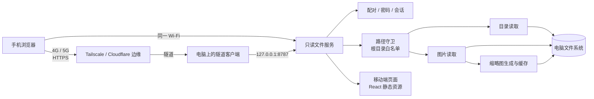
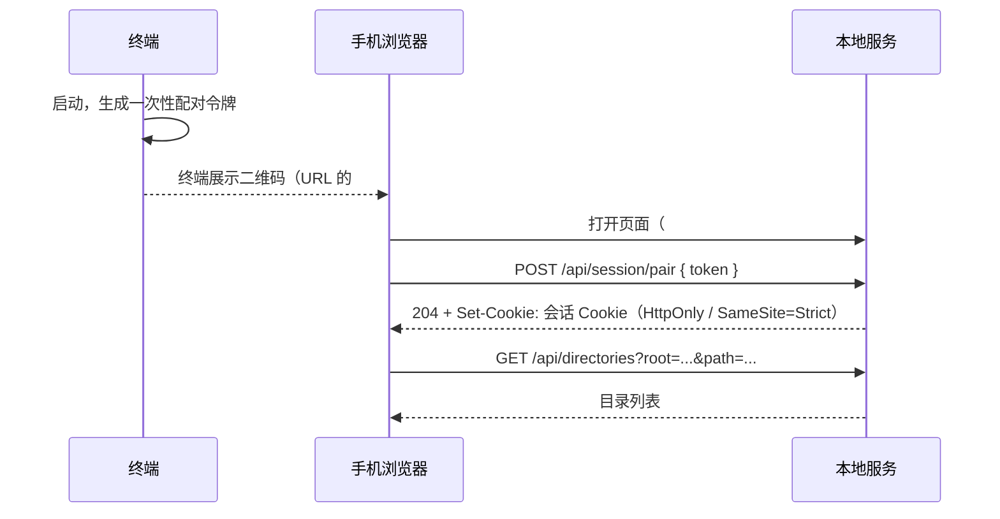
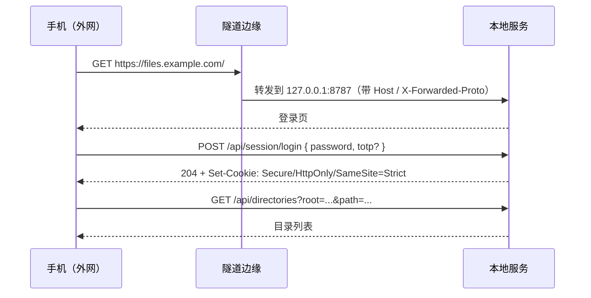

# 手机浏览电脑文件夹与图片 · 功能方案

> **状态**：v0.2，待评审（v0.1 已合并，本版补充外网访问）
> **日期**：2026-11-21
> **需求**：在手机上浏览电脑上的文件夹和图片；只做浏览，不做其他功能；先提交方案评审。补充：不在同一局域网也要能查看。
> **说明**：本 PR 为方案修订，仍不含实现代码。

## 变更记录

| 版本 | 日期 | 变更 |
| --- | --- | --- |
| v0.1 | 2026-11-21 | 初始方案：局域网只读浏览（PR #6，已合并） |
| v0.2 | 2026-11-21 | 增加外网访问：隧道接入、密码登录、公网安全加固；里程碑调整为 M1–M5 |

## 0. 评审摘要

一句话：在电脑上运行一个**只读**的小型 Web 服务，手机既能连同一 Wi-Fi 直接访问，也能在外网通过 **Tailscale / Cloudflare 隧道**访问；外网登录使用访问密码，服务始终只读。

| 待定项 | 本方案建议 |
| --- | --- |
| 形态 | 独立只读 Web 工具（不修改 DSH 本体） |
| 访问方式 | 本机 / 同一局域网 / 外网 三种模式 |
| 外网接入 | 反向隧道接入，**不需要公网 IP、不做路由器端口映射**；首选 Tailscale Serve |
| 外网认证 | 独立的访问密码（scrypt 哈希）+ 会话 Cookie；建议叠加隧道自身身份（Tailscale ACL / Cloudflare Access） |
| 可浏览范围 | 启动时通过 `--root` 指定的白名单根目录，可配置多个 |
| 读写 | 只读：文件接口仅 GET/HEAD，代码中不存在写文件能力（缩略图缓存除外） |
| 图片能力 | 目录缩略图 + 全屏查看 + 左右切换；常见格式优先，HEIC 做兼容预览 |
| 技术栈 | Node.js 22 + TypeScript + Fastify + React/Vite + sharp |
| 交付方式 | 先合并本方案修订，再按 M1–M5 分 PR 实现 |

本次修订的取舍：远程访问采用**“旁路隧道 + 应用自身认证”**，不把服务直接暴露到公网端口，也不自建公网中继服务器。**需要你拍板的事项**见[第 15 节](#15-待确认问题)，都有默认值；没有异议就按默认值实现。

## 1. 背景与目标

### 1.1 场景

用户在电脑上保存了大量照片和文件，希望：

- 在家里用手机直接翻看，不想把照片同步到云盘，也不想安装专用的文件浏览 App；
- 在外面（4G/5G、公司、旅途中）也能临时查看家里电脑上的文件夹和图片；
- 不想为了这个功能把整个电脑或整个 DSH 控制台暴露到公网。

典型动作：

1. 在电脑上启动工具（一条命令），需要外网时再启动隧道。
2. 首次设置访问密码；在局域网可扫码快速配对。
3. 手机打开地址，浏览文件夹，点开图片，左右滑动翻看。
4. 关闭页面/退出服务即结束。

### 1.2 目标

- 手机浏览器（iOS Safari、Android Chrome）可访问电脑上的指定目录。
- 目录浏览：进入子目录、返回上级、面包屑、切换根目录。
- 图片浏览：网格缩略图、全屏大图、左右切换、加载/空/错误状态。
- **外网访问**：不在同一局域网时，通过 HTTPS 仍能浏览；不要求公网 IP，不依赖路由器端口映射。
- 只读：没有上传、删除、重命名、移动、新建、编辑入口。
- 安全默认：根目录白名单 + 令牌/密码 + 路径校验；远程服务只监听回环，默认不暴露公网。
- 部署简单：不需要数据库、不需要云服务、不依赖 DSH 运行；远程接入复用成熟的隧道工具。

### 1.3 非目标

- 不做手机原生 App（Web 页面即可；推荐的 Tailscale 模式只需安装 Tailscale 网络客户端，不安装本工具的 App）。
- **不运营公共中继服务器、不提供内网穿透账号**；远程接入依赖用户已有的 Tailscale / Cloudflare 隧道或自建反向代理。
- **不自动配置路由器端口映射、UPnP 或 DDNS**；不推荐把服务直接暴露在公网 IP 上。
- **不保证公网可用性**：隧道服务中断、电脑休眠、网络切换都会导致暂时不可用。
- 不做文件上传、下载按钮、删除、重命名、移动、新建、编辑。
- 不做全文搜索、图片 OCR、相册按时间聚合、AI 分类。
- 不做视频播放、Office/PDF 预览。
- 不做多用户、分享链接、权限体系；不做团队协作。
- 不替代系统资源管理器，不读取/修改文件属性。

## 2. 用户流程

### 2.1 同一局域网

```text
电脑：npm start -- --lan --root "C:\Users\me\Pictures"
        │
        ├─ 终端打印：本机地址、手机地址、二维码、配对说明
        ▼
手机：相机扫码 → 浏览器打开 → 自动配对 → 进入根目录
        │
        ├─ 点文件夹 → 进入下一级（面包屑可回退）
        ├─ 点图片   → 全屏查看（左右滑动切换、双指/双击缩放）
        └─ 关闭页面 → 结束
```

### 2.2 外网

```text
电脑（只监听 127.0.0.1）：npm start -- --public-url https://my-pc.tailnet-xxxx.ts.net
电脑（另一个终端）：      tailscale serve --bg 8787
手机（4G/5G）：          打开 https://my-pc.tailnet-xxxx.ts.net
                          → 输入访问密码 → 浏览文件夹、看图
```

- 首次外网使用前，在电脑上运行 `--set-password` 设置访问密码；过程中不回显、不写明文。
- 局域网扫码配对仍保留，用于在家快速进入。
- 会话默认保持 30 天；重启服务不会踢掉已登录设备；忘记密码时在电脑上重设。
- 使用 Tailscale Serve 时，手机需安装 Tailscale 并登录同一 tailnet；只开浏览器、不装 Tailscale 的选项见第 10.3 节。

## 3. 现状与方案选型

### 3.1 已有能力

DSH 的 Web GUI 本身已经支持：

- 通过 `--host` 绑定一个局域网地址，启动时打印带一次性令牌的 URL，并用签名 Cookie 认证后续请求。
- 通过 `--public-url` 在反向代理后面提供公网入口，并支持 HTTPS 证书。
- 内置文件侧栏，可列出当前会话工作目录下的目录树，并预览文件。
- 文件读取服务支持按字节范围读取二进制内容，图片理论上可经该通道显示。

但直接复用存在明显不匹配：

1. **目录范围不匹配**：内置文件树以“当前会话工作目录”为根，且目录列举被限制在工作区内；用户想浏览任意照片目录，需要把会话工作目录设到很上层，和 Agent 的会话语义耦合。
2. **界面不匹配**：侧栏是桌面布局，没有为手机设计图片网格、全屏手势和触控目标。
3. **暴露面过大**：为了看图把整个 DSH Web GUI（对话、终端、工具、设置）开放到局域网/手机，超出“只浏览文件夹和图片”的需求；开放到公网更不可接受。
4. **改动位置不对**：改进 DSH 内置文件树属于上游产品改动，不应由本仓库的需求单方面推动。

### 3.2 备选方案

| 方案 | 做法 | 优点 | 缺点 |
| --- | --- | --- | --- |
| A. 扩展 DSH Web | 给 DSH 加一个移动端“文件/相册”页面，复用其认证与文件服务 | 认证、远程访问、TLS 已有；不用新起服务 | 要改 DSH 本体或写客户端插件；手机端等于拿到整个 GUI 的访问权；目录仍受工作区限制；升级耦合 |
| B. 独立只读 Web 服务（**推荐**） | 本仓库内新增小应用，自己起 HTTP 服务、自己做配对和移动端页面 | 攻击面小（只有只读浏览）；界面完全为手机设计；与 DSH 解耦；易测试、易部署 | 需要自己实现认证、路径校验和图片管线；多一个进程 |
| C. 端口映射 / DDNS | 在路由器上把端口映射到公网，用 DDNS 域名访问 | 不依赖第三方隧道 | 暴露家庭 IP；CGNAT 环境不可用；证书、防火墙、安全加固都要自己维护；**不推荐** |
| D. 自建公网中继 / VPS | 在 VPS 上跑 frp/rathole 等反向代理 | 完全可控、可定制 | 需要服务器与运维；公网安全责任更大；超出本工具范围 |

**结论：采用方案 B，并加一层“远程接入适配”。** 理由：

- 需求边界非常窄（只读浏览），独立小工具能把“能做什么”收敛到最小。
- 外网访问不重复造中继，直接用 Tailscale / Cloudflare 这类成熟的隧道：电脑主动建立出站连接，不需要公网 IP，也不需要开路由器端口。
- 隧道只负责传输；应用仍保留自己的密码/会话认证，即使隧道配置失误也不会变成“无认证的公网目录”。

## 4. 总体架构



组件职责：

| 组件 | 职责 |
| --- | --- |
| HTTP 服务 | 监听回环/局域网端口、路由、静态资源、安全响应头 |
| 远程接入适配 | 校验公网 URL、信任来自回环的代理头、HSTS、Host/Origin 白名单 |
| 配对/密码/会话 | 局域网一次性令牌、外网访问密码、Cookie 会话、登出、限流 |
| 路径守卫 | 相对路径解析、根目录包含校验、符号链接策略、隐藏项过滤 |
| 目录服务 | 读取直接子项、排序、类型识别、条数上限 |
| 图片服务 | MIME 识别、原图流式返回、Range/ETag |
| 缩略图 | 按需生成、磁盘缓存、并发限制、失败降级 |
| 移动端页面 | 登录、根目录选择、目录浏览、图片网格、全屏查看、状态提示 |

设计原则：

- **隧道只做传输。** 远程模式默认只监听 `127.0.0.1`，由本机的 Tailscale/cloudflared 转发进来；不打开路由器入站端口。
- **认证不外包。** 即使 Tailscale/Cloudflare 有身份层，应用仍要求自己的密码/会话；多层防护，任何一层失效都不至于裸奔。
- **单进程、单用户、无数据库。** 配置在启动参数/配置文件里，会话与缓存落在本地文件。
- **服务端只读。** 所有文件系统调用限定为列目录、stat、读文件；唯一会写的是缩略图缓存目录。
- **手机端不依赖公网资源。** 无 CDN、无字体外链、无遥测；断连时明确提示。

## 5. 认证与配对

### 5.1 局域网配对



要点：

- 配对令牌为 32 字节随机数，只在内存中保存哈希，10 分钟过期，配对成功即作废。
- 令牌放在 URL `#fragment` 中，浏览器不会把它发给服务器，也不进入 Referer 和服务端访问日志；页面加载后由前端读取并 POST 换取 Cookie，随后用 `history.replaceState` 清掉 fragment。
- 会话 Cookie：`HttpOnly; SameSite=Strict; Path=/; Max-Age=30d`，HTTPS 下追加 `Secure`。Cookie 只保存随机会话 ID，服务端只存它的哈希。
- 会话表持久化在用户配置目录（权限 0600），否则每次重启都要重新扫码。
- `--reset-sessions` 删除所有会话；`POST /api/session/logout` 退出当前设备。
- 配对接口限流：同一 IP 10 分钟内最多 10 次失败，超出返回 429；令牌熵足够，不做验证码。

### 5.2 外网密码登录

外网模式不使用 URL 中的一次性令牌作为主要登录方式（公共网络不适合在地址栏长期携带秘密），改用访问密码：



- **设置密码**：首次运行 `npm start -- --set-password`，交互输入两次；密码只以 scrypt 哈希保存（N=2^15, r=8, p=1，16 字节随机盐，32 字节输出），文件权限 0600；不把明文写进配置、命令行参数或日志。
- **密码要求**：至少 12 个字符；提示用户使用长口令；不做“密保问题”或邮件找回。
- **登录**：`POST /api/session/login`，成功后签发与会话 Cookie 相同的凭据；失败统一返回 401，不区分“密码错”还是“TOTP 错”。
- **限流/锁定**：同一 IP 每分钟最多 5 次失败、全局每小时最多 20 次失败；连续失败触发指数退避，15 分钟内锁定；登录接口有固定延迟，避免时序泄露。
- **TOTP（可选加固）**：可选的 6 位动态验证码，作为第二因素；默认关闭，M5 视需要实现。
- **会话**：默认 30 天；登录时轮换会话 ID；`--reset-sessions` 可立即让所有设备失效。
- **找回**：忘记密码只能在电脑上重设（`--set-password`）；这是有意为之，避免引入可被远程攻击的找回通道。
- **外层身份（建议开启，非强制）**：Tailscale ACL 限定只有自己的设备能进 tailnet；Cloudflare Access 用邮箱 OTP/SSO 作为第二道门。应用内密码仍然保留。

### 5.3 模式与监听地址

| 模式 | 启动参数 | 监听 | 主要认证 |
| --- | --- | --- | --- |
| 本机 | 默认 | `127.0.0.1` | 一次性令牌 |
| 局域网 | `--lan` | 局域网网卡 / `0.0.0.0` | 一次性令牌 |
| 外网 | `--public-url https://...` | **默认 `127.0.0.1`** | 访问密码 + 会话 |

`--public-url` 只接受 `https://` 且不带路径的源（例如 `https://files.example.com`）；HTTP 公网 URL 直接拒绝启动。远程模式若未设置密码，同样拒绝启动，避免“开了隧道却没有认证”。

同时开启 `--lan` 与 `--public-url` 时启动打印警告，建议只保留回环监听。

## 6. 功能与交互设计

### 6.1 目录浏览页

- 顶部：当前根目录名称、切换根目录入口。
- 面包屑：横向可滚动，点击任意一级跳转；根目录显示为配置时的名称（如“图片”），不暴露绝对路径。
- 列表：目录在前，其次图片，最后其他文件；按名称自然排序（数字感知、忽略大小写）。
- 目录行：文件夹图标 + 名称 + 修改时间；点击进入。
- 图片：3 列网格缩略图（窄屏），宽屏自动增加列数；点击进入全屏查看。
- 非图片文件：显示文件名，置灰不可打开（本期只支持图片预览）。
- 空目录、读取失败、条目过多、断连各有明确提示。
- 不显示绝对路径；面包屑从根目录算起。

### 6.2 图片查看页

- 全屏深色背景，图片等比完整显示。
- 顶部返回按钮 + 文件名；底部 `当前序号 / 总数`。
- 左右滑动切换上一张/下一张；到达首尾有边界反馈，不循环。
- 支持双指缩放与双击放大（M3 完善；M2 先做点击放大/原尺寸查看）。
- 预加载相邻图片的低优先级请求，滑动时更顺滑；开启“省流量”时跳过预加载。
- 加载中显示占位；加载失败显示“这张图片无法显示”，可点重试；支持手势返回。
- 浏览器自带的长按保存图片不受限制，但产品不提供“保存到相册”按钮。

### 6.3 页面线框（示意，非最终视觉）

```text
┌──────────────────────────────────┐
│ 图片文件夹            切换根目录 │
│ 首页 / 图片 / 2026-11-21         │
├──────────────────────────────────┤
│ > 2026-11-20 杭州                │
│ > 截图                           │
│ > 微信图片                       │
├──────────────────────────────────┤
│ [缩略图] [缩略图] [缩略图]       │
│ [缩略图] [缩略图] [缩略图]       │
└──────────────────────────────────┘
```

```text
┌──────────────────────────────────┐
│ <  IMG_20261121_083012.jpg       │
│                                  │
│                                  │
│           [ 图片 ]               │
│                                  │
│                                  │
│   <    12 / 238    >             │
└──────────────────────────────────┘
```

### 6.4 外网登录页

- 只在配置了访问密码时出现；密码框 + 显示/隐藏 + 进入按钮。
- 错误提示统一为“密码不正确或已锁定”，不显示剩余尝试次数等细节。
- 不提供“忘记密码”链接，页面提示到电脑上重设。
- 登录页与浏览页同源，无第三方脚本、无外链字体。
- TOTP 开启时增加 6 位验证码输入框。

```text
┌──────────────────────────────────┐
│ 手机文件                         │
│                                  │
│ 访问密码                         │
│ [ •••••••••••••• ]               │
│                                  │
│ [            进入            ]   │
│                                  │
│ 连续输错会被暂时锁定             │
└──────────────────────────────────┘
```

### 6.5 状态与异常

| 场景 | 表现 |
| --- | --- |
| 未配对/会话过期 | 跳转登录页；局域网提示扫码，外网提示输入密码 |
| 密码错误/被锁定 | 统一的“密码不正确或已锁定”，不泄露细节 |
| 路径越界/无权限 | 统一的“无法访问该位置”，不返回服务器真实路径 |
| 目录不存在 | “文件夹可能已被移动或删除”，提供返回上级 |
| 图片格式不支持 | “此格式暂不支持预览”，保留缩略图/文件名 |
| 条目超过上限 | 列表末尾提示“仅显示前 2000 项，请进入更具体的文件夹” |
| 手机与电脑断连 | 顶部横幅“与电脑的连接已断开”，恢复后自动重试一次 |
| 隧道断开/电脑休眠 | 同断连；提示检查电脑和隧道是否在运行 |
| 公网证书错误 | 提示检查隧道域名与证书，不继续发送登录请求 |
| 电脑休眠/服务退出 | 同上，不无限重试 |

## 7. 接口设计

所有接口同源，除配对/登录/健康检查外都需要会话 Cookie。文件相关接口仅支持 `GET`/`HEAD`；其他方法统一 `405`。

| 方法 | 路径 | 说明 |
| --- | --- | --- |
| `GET` | `/` | 移动端页面（SPA） |
| `GET` | `/healthz` | 存活检查，返回 `{ "ok": true }`，不含版本/路径信息 |
| `POST` | `/api/session/pair` | `{ token }` 换取会话 Cookie（局域网/首次配对） |
| `POST` | `/api/session/login` | `{ password, totp? }` 外网密码登录 |
| `POST` | `/api/session/logout` | 注销当前会话 |
| `GET` | `/api/session` | 当前会话状态（是否已登录、模式、剩余有效期） |
| `GET` | `/api/roots` | 已配置的根目录列表 |
| `GET` | `/api/directories?root=<id>&path=<相对路径>` | 列出一级子项 |
| `GET` | `/api/thumbnails?root=<id>&path=<相对路径>&w=640` | 图片缩略图（WebP/JPEG） |
| `GET` | `/api/images?root=<id>&path=<相对路径>` | 原图字节流，支持 Range |

目录返回示例：

```json
{
  "root": { "id": "pictures", "name": "图片" },
  "path": "2026-11",
  "breadcrumb": [
    { "name": "图片", "path": "" },
    { "name": "2026-11", "path": "2026-11" }
  ],
  "entries": [
    { "name": "杭州", "kind": "directory", "mtime": "2026-11-20T10:00:00.000Z" },
    {
      "name": "IMG_0001.jpg",
      "kind": "image",
      "size": 4821333,
      "mtime": "2026-11-21T08:30:12.000Z",
      "thumbUrl": "/api/thumbnails?root=pictures&path=2026-11%2FIMG_0001.jpg"
    }
  ],
  "truncated": false,
  "sort": "name"
}
```

错误统一为：

```json
{ "error": { "code": "forbidden-path", "message": "无法访问该位置" } }
```

错误码：`unauthorized`、`invalid-credentials`、`forbidden-path`、`not-found`、`not-directory`、`unsupported-image`、`rate-limited`、`internal`。对外消息不包含绝对路径、堆栈或系统错误原文；登录失败统一用 `invalid-credentials`，不区分具体原因。

缓存策略：

- 目录列表：`Cache-Control: no-store`。
- 原图：`ETag`（mtime + size + 编码格式）、`Cache-Control: private, max-age=86400`，支持 `Range` 以便大图流式加载和 iOS 重试。
- 缩略图：`ETag`（mtime + size + 宽度 + 版本）、`Cache-Control: private, max-age=604800`；变更后 ETag 自然失效。

公网相关：

- `--public-url` 决定允许的 Host 与 `Secure` Cookie；`Secure` 以配置的 scheme 为准（远程模式只接受 `https://`），不单靠代理头。请求来自回环代理时信任 `X-Forwarded-Proto`/`X-Forwarded-For`，来自非回环连接时忽略这些头；`X-Forwarded-Proto` 主要用于一致性校验与日志。
- HTTPS 下返回 `Strict-Transport-Security: max-age=15552000`。
- 登录接口限制请求体大小（例如 8 KB），防止无认证的大请求消耗。

## 8. 安全设计

### 8.1 威胁模型

| 威胁 | 缓解 |
| --- | --- |
| 同一 Wi-Fi 下的陌生人访问 | 必须配对令牌；Cookie 会话；失败限流；默认不监听局域网 |
| **公网扫描/爬虫** | 未登录的文件/API 请求全部 401，页面显示登录页；登录限流；错误信息统一；无目录索引；不暴露版本 |
| **密码爆破/撞库** | 至少 12 位密码；scrypt 慢哈希；按 IP + 全局限流；锁定与退避；可选 TOTP |
| **公网 TLS 被降级/劫持** | 远程 URL 强制 `https://`；HSTS；Cookie `Secure`；HTTP 公网 URL 拒绝启动 |
| **代理头伪造** | 只信任来自回环的 `X-Forwarded-*`；Host/Origin 白名单；`--public-url` 校验 |
| **隧道账号被攻破** | Tailscale/Cloudflare 账号开启 2FA；ACL/Access 最小权限；应用密码仍在，不单点信任 |
| **公网 DoS/慢连接** | 隧道边缘吸收大部分流量；应用侧请求体/超时/并发限制；未认证路径不执行昂贵操作 |
| **DDNS/家庭 IP 暴露** | 不推荐端口映射；隧道方案不需要公网 IP；文档明确反对直接暴露 |
| 路径穿越（`../`、编码绕过、绝对路径） | 只接受相对路径 + 逐段校验 + `realpath` 包含校验 |
| 符号链接逃逸到白名单外 | 默认不跟随符号链接；跟随则必须 `realpath` 后仍在根目录内 |
| 文件名/目录名 XSS | React 默认转义；禁止 `dangerouslySetInnerHTML`；严格 CSP |
| 伪装成图片的 HTML/SVG | 按魔数嗅探 + 图片类型白名单；`X-Content-Type-Options: nosniff`；不提供 SVG |
| 图片炸弹/超大图耗尽内存 | sharp `limitInputPixels`、尺寸上限、并发 4、失败降级 |
| 令牌泄漏到日志/Referer | 局域网令牌放 `#fragment`；不打日志；`Referrer-Policy: no-referrer` |
| Cookie 被窃取 | `HttpOnly`、`SameSite=Strict`、HTTPS 下 `Secure`、可一键失效 |
| 误暴露公网 | 不自建公网中继；远程模式只监听回环；启动打印风险提示；README 明确边界 |
| 隧道服务元数据泄露 | 选用可信隧道服务；披露其可见的连接元数据；不记录文件内容 |

### 8.2 路径守卫规则

```text
1. 只接受相对路径；拒绝空段、NUL、绝对路径、盘符（C:）、UNC（\\）、设备路径（\\?\）
2. 按 / 与 \ 拆分（Windows 兼容），拒绝 . 和 ..（在一次 URL 解码之后判断）
3. 拼接 root.realPath + 各段，得到候选路径
4. 对目标做 realpath；不存在时对最近存在的父目录做 realpath
5. path.relative(root.realPath, resolved) 必须是相对路径且不以 .. 开头
6. Windows 下比较忽略大小写；macOS 下按卷的大小写策略
7. 默认 lstat 检测到符号链接即拒绝（列目录时显示为不可打开的“其他”项）
```

补充：

- 所有错误对客户端统一为 `forbidden-path`/`not-found`，避免通过错误差异探测目录是否存在。
- 目录读取使用 `withFileTypes`，只读取直接子项，不递归、不预读。
- 路径中的中文、emoji、空格通过 URL 编码正常传递；服务端按 UTF-8 拼接，不做 NFC/NFD 归一化（macOS 文件名兼容在测试中覆盖）。
- Windows 保留名、260 字符以上长路径、盘符根目录在测试矩阵中覆盖。

### 8.3 只读保证

- 数据接口只注册 `GET`/`HEAD`；文件系统调用只有 `readdir`、`lstat`、`realpath`、`createReadStream`。
- 唯一的写操作是缩略图缓存（独立的缓存目录），不触碰用户文件。
- 测试用“对临时目录计算哈希后比对”验证浏览过程不修改文件；对 `PUT/PATCH/DELETE` 断言 405。

### 8.4 安全响应头

`Content-Security-Policy: default-src 'self'; img-src 'self' blob:; style-src 'self'; script-src 'self'; connect-src 'self'; frame-ancestors 'none'; base-uri 'none'`

同时设置：`X-Content-Type-Options: nosniff`、`Referrer-Policy: no-referrer`、`X-Frame-Options: DENY`、`Cross-Origin-Opener-Policy: same-origin`、`Cross-Origin-Resource-Policy: same-origin`，HTTPS 下增加 `Strict-Transport-Security`。

### 8.5 隐私

- 无遥测、无外部请求、无云同步；缩略图只缓存在本机。
- 访问日志默认关闭；`--verbose` 打开时也不记录完整文件路径，只记录方法、状态码和耗时。
- 远程访问会经过第三方隧道：Tailscale 使用 WireGuard，服务方通常只能看到连接元数据；Cloudflare 在边缘终止 TLS，服务方理论上能看到经过的 HTTP 内容。应选择可信服务商，敏感场景优先 Tailscale Serve。README 明确说明这一点。
- 文档与 PR 中不使用真实个人目录、照片或内网地址。

### 8.6 远程访问加固

- **强制 HTTPS**：`--public-url` 必须是 `https://` 且不带路径；公网 HTTP 直接拒绝启动。
- **只监听回环**：远程模式默认 `127.0.0.1`；`--lan` 需显式开启，同时开启时打印警告。
- **可信代理**：只有来自 `127.0.0.1`/`::1` 的请求才采信 `X-Forwarded-*`；其他来源一律忽略，防止伪造客户端 IP 绕过限流。
- **Host/Origin 校验**：Host 必须是 `--public-url` 的主机或显式 `--trusted-host`；跨站 POST 拒绝。
- **密码与会话**：scrypt 哈希、固定延迟、失败限流、锁定；会话 ID 轮换；`--reset-sessions` 立即吊销。
- **外层身份**：Tailscale Serve 仅 tailnet 可达；Cloudflare Tunnel 建议配 Access；Quick Tunnel 只作临时使用。
- **最小信息**：错误页不返回路径、版本、内部主机名；`/healthz` 只返回 `{ok:true}`。
- **可运维**：启动打印当前模式、监听地址、公网 URL 与隧道提示；README 给出排障和撤销步骤。

## 9. 图片处理与性能

### 9.1 支持格式

| 格式 | 缩略图 | 全屏查看 | 说明 |
| --- | --- | --- | --- |
| JPEG / PNG / WebP / GIF / BMP / AVIF | ✅ | ✅ | 浏览器原生支持；GIF/动态 WebP 全屏时保留动画 |
| HEIC / HEIF | ✅（服务端转码） | ⚠️ 服务端转 JPEG 预览 | iPhone 照片常见；Safari 原生可看，Chrome 不可，统一服务端兜底 |
| SVG | ❌ | ❌ | 有脚本执行风险，本期不支持 |
| TIFF / RAW / PSD | ❌ | ❌ | 后续按需扩展 |

### 9.2 缩略图管线

1. 校验扩展名白名单 + 读取文件头魔数，两者一致才处理。
2. 交给 sharp：`rotate()` 处理 EXIF 方向 → 缩放到最大边 640px → WebP 质量 80。
3. 磁盘缓存键：`sha256(rootId + 相对路径 + mtimeMs + size + 宽度 + 管线版本)`，文件放缓存目录，扩展名 `.webp`。
4. 并发上限 4，超出排队；单张失败只影响该图，返回占位错误，不拖垮列表。
5. 缩略图缓存启动时清理超过 30 天或超过 2 GB 的旧文件（可配置）。
6. 原图接口单独返回，不经过 sharp；大图流式传输，不整体读入内存。

### 9.3 性能目标

| 指标 | 目标 |
| --- | --- |
| 服务启动 | < 2 秒 |
| 1000 项目录首屏（不含缩略图） | < 1 秒（局域网） |
| 首屏缩略图（缓存命中） | < 300 毫秒（局域网） |
| 首屏缩略图（首次生成） | < 2 秒（取决于图片大小） |
| 外网首屏（4G，缩略图缓存命中） | < 3 秒 |
| 原图打开 | 以设备带宽为限，边下边显示 |
| 空闲内存 | < 100 MB（不含 sharp 处理峰值） |

### 9.4 大目录与大图

- 单目录最多返回 2000 项（可配置），超出标记 `truncated`，不递归、不分页加载更多（提示进入子目录）。
- 图片网格使用 `loading="lazy"` + `IntersectionObserver` 预取可视区。
- 单张图片解码像素上限默认 1 亿像素；超限返回不可预览。
- 不做全量目录扫描，不做缩略图预热。

### 9.5 外网传输

- 缩略图优先：网格只拉 640px WebP（单张约 30–80 KB），不自动预加载原图。
- 原图使用 Range + ETag，弱网中断后可续传/复用缓存。
- 尊重 `navigator.connection.saveData`：开启省流量时减少预取、关闭相邻图预加载。
- 隧道延迟通常只增加一两个 RTT，主要成本仍是图片字节数；不在服务端做无损二次压缩。
- 电脑上行带宽决定外网体验；README 给出“外网看图建议上行 ≥ 5 Mbps”的说明。

## 10. 配置、启动与部署

### 10.1 启动示例

局域网（Windows PowerShell）：

```powershell
npm ci
npm run build
npm start -- --lan --root "C:\Users\me\Pictures" --root "C:\Users\me\Desktop"
```

外网（电脑只监听回环）：

```powershell
# 首次：设置访问密码
npm start -- --set-password

# 启动服务并声明公网地址
npm start -- --root "C:\Users\me\Pictures" --public-url https://my-pc.tailnet-xxxx.ts.net

# 另一个终端：把 Tailscale 的 HTTPS 入口指向本机
tailscale serve --bg 8787
tailscale serve status
```

macOS / Linux 同理，把路径换成 `~/Pictures`；Tailscale 安装后执行相同的 `tailscale serve` 命令。

启动输出示意：

```text
mobile-files 0.2.0
模式      远程（仅回环）
本机访问  http://127.0.0.1:8787/
公网地址  https://my-pc.tailnet-xxxx.ts.net   （需隧道已启动）
[二维码]
会话有效期 30 天；Ctrl+C 退出
```

### 10.2 配置项

| 参数 | 默认 | 说明 |
| --- | --- | --- |
| `--root <路径>` | 必填，可重复 | 允许浏览的根目录；启动时校验存在并解析为真实路径 |
| `--lan` | 关闭 | 监听所有网卡，允许同一局域网访问；不加则只监听 127.0.0.1 |
| `--public-url <URL>` | 无 | 外网 HTTPS 源；设置后进入远程模式，要求已设密码 |
| `--set-password` | — | 交互设置/修改访问密码，保存哈希后退出 |
| `--trusted-host <host>` | 无 | 隧道改写 Host 时额外允许的主机名，可重复 |
| `--port <端口>` | `8787` | 监听端口；被占用时启动失败并给出提示 |
| `--config <文件>` | 无 | JSON 配置文件路径；命令行参数优先 |
| `--show-hidden` | 关闭 | 显示点号开头的文件/目录及系统目录 |
| `--max-entries` | `2000` | 单目录返回上限 |
| `--thumb-width` | `640` | 缩略图最大边像素 |
| `--thumbs-dir` | 系统缓存目录 | 缩略图缓存位置 |
| `--thumbs-max-size` | `2GB` | 缓存容量上限 |
| `--session-ttl` | `30d` | 会话有效期 |
| `--tls-cert` / `--tls-key` | 无 | 本地 HTTPS（一般由隧道终止 TLS，可不用） |
| `--reset-sessions` | — | 启动时清空所有会话 |
| `--verbose` | 关闭 | 调试日志（仍不打印完整路径与密码） |

TOTP 开关在 M5 视需要加入（如 `--enable-totp`），本期不默认开启。

配置文件示例：

```json
{
  "roots": [
    { "id": "pictures", "name": "图片", "path": "C:\\Users\\me\\Pictures" },
    { "id": "desktop", "name": "桌面", "path": "C:\\Users\\me\\Desktop" }
  ],
  "lan": false,
  "publicUrl": "https://my-pc.tailnet-xxxx.ts.net",
  "port": 8787,
  "showHidden": false,
  "maxEntries": 2000
}
```

根目录在界面上只显示 `name`；`id` 用于 API，不暴露真实路径。密码不以明文进入配置文件。

### 10.3 远程接入方式

| 方式 | 手机需要 | 电脑需要 | 公网暴露 | URL 稳定 | 适用场景 |
| --- | --- | --- | --- | --- | --- |
| 同一局域网 | 浏览器 | 无 | 否 | 是 | 家里 |
| **Tailscale Serve（推荐）** | Tailscale App + 账号 | Tailscale + 账号 | 否，仅 tailnet | 是 | 日常外网访问，最安全 |
| Tailscale Funnel | 浏览器 | Tailscale + 账号 | 是（公网 HTTPS） | 是 | 不想装手机 App 的个人使用 |
| Cloudflare Tunnel + Access | 浏览器 | cloudflared + Cloudflare 账号/域名 | 是（Access 保护） | 是 | 有域名，想用邮箱 OTP/SSO |
| Cloudflare Quick Tunnel | 浏览器 | cloudflared（无需账号） | 是（临时 URL） | 否 | 临时试用，不作为长期入口 |
| VPS + frp/rathole | 浏览器 | VPS + 运维 | 是 | 是 | 进阶用户 |

不存在“零账号、零安装、又长期稳定”的公网入口：Quick Tunnel 只适合临时验证，长期使用需要 Tailscale/Cloudflare 账号或自己的 VPS。本工具不代持这些账号，也不把账号信息写入代码仓库。

推荐流程（Tailscale Serve，私有）：

1. 电脑和手机安装 Tailscale，登录同一个 tailnet。
2. 在 tailnet 管理后台启用 HTTPS 证书（MagicDNS 名称，如 `my-pc.tailnet-xxxx.ts.net`）。
3. 电脑上设置密码并启动服务：`npm start -- --set-password`，再 `npm start -- --public-url https://my-pc.tailnet-xxxx.ts.net`。
4. 另一个终端执行 `tailscale serve --bg 8787`，用 `tailscale serve status` 确认 HTTPS URL。
5. 手机切到 4G/5G，打开该 URL，输入密码。
6. 撤销：`tailscale serve --https=443 off`（或按 Tailscale 当前文档关闭），并可在电脑上 `--reset-sessions`。

Tailscale Funnel（浏览器直达，公网）：

- 适合“手机不想装 Tailscale”的场景，但地址对整个互联网可达。
- 必须设置强密码；建议同时开启 TOTP（M5）。
- Funnel 的公网端口只能是 443、8443 或 10000，具体限制以 Tailscale 当前文档为准；本工具仍只监听回环。
- 不建议把 Funnel 当成默认方案。

Cloudflare Tunnel + Access（浏览器直达，可控）：

- 需要 Cloudflare 账号；命名隧道通常需要自己的域名。Quick Tunnel 不需要账号，但地址随机、生命周期短。
- 命名隧道指向 `http://127.0.0.1:8787`，在 Cloudflare Zero Trust 里加 Access 策略（邮箱 OTP/SSO）。
- 启动服务时传 `--public-url https://files.example.com`，保证 Cookie/HSTS/Host 校验一致。
- Quick Tunnel 命令示例：`cloudflared tunnel --url http://127.0.0.1:8787`；无需账号，但 URL 每次变化、无 uptime 保证、最多 200 个并发请求、不支持 SSE（本工具不使用 SSE）；只用于临时验证，必须设密码。

VPS + frp/rathole：仅提供文档指引，不作为内置功能；需要自行维护公网入口、TLS 和防火墙。

### 10.4 防火墙与常见问题

- **远程模式不需要在路由器上开任何入站端口**；只需电脑能出站访问隧道服务（通常 HTTPS 443），Tailscale 还需 UDP 41641 或 DERP 中继。
- Windows 首次监听局域网会弹出防火墙提示：只勾选“专用网络”，不要勾选“公用网络”。
- 局域网模式下手机和电脑必须在同一 Wi-Fi；路由器“AP 隔离/访客网络”会导致互不可见。
- 外网打不开：先确认 `tailscale serve status` / `cloudflared` 是否在运行，再确认 `--public-url` 与浏览器地址完全一致（含子域名）。
- 登录后立刻掉线：检查 Cookie 是否被浏览器的“阻止第三方 Cookie/隐私模式”拦截；HTTPS 下 Secure Cookie 不会在 HTTP 页面生效。
- 公网证书错误：确认隧道域名与证书匹配；不要在证书错误页继续输入密码。
- 启动日志提示 Host 不被允许：说明隧道改写了 Host；核对 `--public-url`，或用 `--trusted-host` 加入实际 Host。
- 电脑休眠会断开远程访问；需要时在系统电源设置中允许网络唤醒。
- 端口被占用：换 `--port`；启动失败会打印明确提示。
- 手机与电脑不在同一网络时，局域网地址当然不可用；请使用第 10.3 节的远程方式。

### 10.5 不推荐的做法

- **路由器端口映射 + DDNS**：会把家庭 IP 直接暴露到公网，CGNAT 下还不可用，证书和防火墙都要自己维护。
- **UPnP 自动开洞**：不可控、容易被滥用，本工具不实现。
- **无密码的公网隧道**：即使 URL 随机也不安全；远程模式强制密码。
- **把 `--lan` 和公网端口同时开放**：没有必要，优先回环 + 隧道。

## 11. 工程结构

```text
apps/mobile-file-browser/
├─ package.json
├─ tsconfig.json
├─ vite.config.ts
├─ README.md                 # 安装、启动、远程接入、排障
├─ src/
│  ├─ server/
│  │  ├─ index.ts            # CLI、配置、启动
│  │  ├─ app.ts              # Fastify 组装、安全头、静态资源
│  │  ├─ auth/
│  │  │  ├─ pairing.ts       # 一次性配对令牌
│  │  │  ├─ password.ts      # scrypt 哈希、设置/校验
│  │  │  ├─ session.ts       # Cookie 会话、持久化、吊销
│  │  │  └─ rate-limit.ts    # 登录/配对限流
│  │  ├─ remote.ts           # public URL、代理头、HSTS、Host/Origin
│  │  ├─ paths.ts            # 根目录、路径守卫
│  │  ├─ directories.ts      # 列目录、排序、过滤
│  │  ├─ images.ts           # 魔数识别、原图流、Range/ETag
│  │  ├─ thumbnails.ts       # sharp、缓存、并发控制
│  │  └─ errors.ts           # 统一错误映射
│  ├─ web/
│  │  ├─ main.tsx
│  │  ├─ pages/Login.tsx
│  │  ├─ pages/Browse.tsx
│  │  ├─ pages/Viewer.tsx
│  │  ├─ components/         # 面包屑、网格、空状态、对话框
│  │  ├─ api.ts
│  │  └─ styles.css
│  └─ shared/types.ts        # 前后端共享类型
├─ test/
│  ├─ unit/
│  ├─ integration/
│  └─ e2e/
└─ playwright.config.ts
```

技术选型：

| 选择 | 理由 |
| --- | --- |
| Node.js 22 LTS + TypeScript | 跨平台、零额外运行时；用户机器通常已有 Node |
| Fastify | 轻量、路由/静态资源/流式响应成熟，插件少 |
| React + Vite | 组件化、构建简单、移动端生态成熟 |
| sharp | 缩略图性能好、支持 EXIF 方向；HEIC 取决于构建，需在 M3 实测 |
| `node:crypto` scrypt | 密码慢哈希内置，无需额外原生依赖 |
| 外部隧道 CLI | Tailscale/cloudflared 由用户安装，不打包进应用；M5 可选自动拉起 |
| Vitest + Playwright | 单测/集成/E2E 一条链；Playwright 可模拟手机视口 |
| 无数据库 | 配置即状态，减少部署负担 |

仓库当前没有构建约定，本期会在 `apps/mobile-file-browser/` 内自带 `package.json` 与脚本，不影响仓库根目录。

## 12. 测试与验收

### 12.1 自动化测试

- **单元**：路径守卫（`..`、URL 编码、绝对路径、盘符、UNC、符号链接、Windows 大小写、中文/emoji 文件名）；图片类型识别；排序；配对令牌过期；scrypt 哈希/校验；登录限流；公网 URL 校验。
- **集成**：临时目录 + Fastify `inject`，覆盖未认证 401、越界 403、不存在 404、非目录 400、超限截断、Range 206、ETag 304、非 GET 方法 405。
- **认证**：密码错误/正确；Cookie 的 `HttpOnly`/`SameSite`/`Secure`；HTTPS 下 HSTS；登录失败限流与锁定；`--reset-sessions` 后旧 Cookie 失效。
- **代理/Host**：模拟来自回环的 `X-Forwarded-Proto: https` 与 `X-Forwarded-For`；断言非回环请求的伪造头被忽略；Host/Origin 不匹配被拒绝；HTTP 公网 URL 启动失败。
- **E2E**：Playwright 手机视口（iPhone 13 / Pixel 7），配对/密码登录 → 列目录 → 进子目录 → 打开图片 → 左右切换 → 断连提示。
- **CI**：GitHub Actions 在 Ubuntu / Windows / macOS 上跑单元与集成测试，Node 22。

### 12.2 手工验收清单

- iPhone Safari 与 Android Chrome 各验证一次：扫码、浏览、看图、横竖屏。
- 中文、空格、emoji、超长文件名正常显示和打开。
- 1000+ 项目录不卡死，截断提示正确。
- 50 MB 大图能打开，不导致服务崩溃。
- HEIC 照片能显示（缩略图至少可用）。
- 手机与电脑不在同一网络时，通过 Tailscale Serve 用 4G/5G 成功登录并看图。
- 用 Cloudflare Quick Tunnel 做一次临时验证（只作测试，不作长期入口）。
- 关闭隧道/服务后手机页面显示断连提示。
- 未登录访问公网地址返回登录页；连续输错后出现锁定提示。
- 公网 URL 与 `--public-url` 不一致时被拒绝，不泄露内部地址。
- 在电脑上确认服务只监听 `127.0.0.1`（`netstat`/`ss`），没有额外的入站端口。

### 12.3 验收标准

1. 手机扫码后 10 秒内进入根目录（局域网）。
2. 可浏览白名单内的多级目录，面包屑与返回行为正确。
3. 图片网格与全屏查看可用，支持左右切换。
4. 白名单外的路径（含 `../`、编码变形、符号链接逃逸）全部拒绝，且不泄露真实路径。
5. 未配对/未登录请求全部 401；文件接口非 GET/HEAD 全部 405。
6. 浏览过程不修改任何用户文件（哈希校验通过）。
7. 1000 项目录首屏 < 1 秒，缩略图缓存命中 < 300 毫秒（局域网）。
8. 默认仅监听回环地址；`--lan` 启动时明确提示风险。
9. **外网（4G/5G）通过 Tailscale Serve 或 Cloudflare Tunnel 登录后可浏览目录、查看图片。**
10. **远程模式只监听回环、无路由器入站端口；`http://` 公网 URL 被拒绝；HTTPS 下 Cookie 为 `Secure` 且返回 HSTS。**
11. **未登录访问目录/图片接口返回 401，页面显示登录页；密码连续错误触发 429/锁定；Host/Origin 不匹配的请求被拒绝。**
12. **隧道断开或电脑休眠时，页面给出明确提示，不泄露内部地址。**

## 13. 里程碑

| 阶段 | 内容 | 退出条件 |
| --- | --- | --- |
| M1 骨架与安全 | 服务启动、CLI/配置、配对认证、路径守卫、目录 API、最简列表页、单测/集成测试 | 手机能配对并看到根目录列表；越界与未认证测试通过 |
| M2 浏览与看图 | 目录/图片列表、面包屑、根切换、网格、全屏查看、左右切换、状态处理 | 手工走通“浏览 → 看图 → 切换”；E2E 通过 |
| M3 缩略图与性能 | sharp 管线、磁盘缓存、HEIC 兼容、Range/ETag、懒加载、并发限制、缩放交互 | 达到第 9.3 节性能目标；大图/大目录测试通过 |
| M4 远程访问 | `--public-url`、密码登录、限流、代理头/Host/Origin、HSTS/Secure Cookie、Tailscale/Cloudflare 接入文档与集成测试 | 4G/5G 经 Tailscale 登录并看图；无入站端口；认证与代理测试通过 |
| M5 交付打磨 | 可选 `--tunnel` 启动器、可选 TOTP、README/排障、Windows 防火墙指南、跨平台 CI、手工验收记录 | 可日常使用，按第 12.3 节逐项验收 |

每个阶段单独 PR，保持可评审、可回滚。**M4 是本次新增的远程访问里程碑**；如果希望远程能力更早可用，可以把它和 M3 并行，但实现上先完成回环 + 密码认证再接隧道。

## 14. 风险与备选

| 风险 | 影响 | 应对 |
| --- | --- | --- |
| 隧道服务/账号依赖 | 服务中断、需要注册 | 文档给出 Tailscale、Cloudflare、VPS 多种选择；远程失败不影响局域网 |
| 公网暴露被扫描/爆破 | 隐私泄露 | 强密码 + scrypt + 限流 + 锁定 + 可选 TOTP；推荐用 Tailscale Serve 不暴露公网 |
| 密码弱或泄露 | 越权访问 | 至少 12 位；统一错误；可 `--reset-sessions`；建议叠加 Access/ACL |
| 隧道 URL 变化（Quick Tunnel） | Cookie/会话失效 | 只作临时使用；长期用命名隧道或 Tailscale 稳定域名 |
| 手机需安装 Tailscale | 使用门槛 | 同时提供 Funnel/Cloudflare 的“浏览器直达”备选 |
| 移动数据消耗 | 流量费用 | 缩略图优先、懒加载、不自动预加载原图、尊重省流量 |
| 电脑休眠/断网 | 远程不可用 | 页面明确提示；可配置电源/网络唤醒；这是自托管服务的固有边界 |
| HEIC 在 Chrome/Android 无法原生显示 | iPhone 照片看不了 | 服务端 sharp 转码为 JPEG 预览；M3 实测，失败则明确提示 |
| 超大图片/超大目录 | 卡顿或内存占用 | 像素上限、条数上限、流式传输、并发限制 |
| 符号链接/路径绕过 | 越权读取 | 多层校验 + 专项测试；默认不跟随符号链接 |
| 浏览器长按保存图片 | 无法完全阻止 | 属于浏览器能力；文档说明，不提供下载按钮 |
| 需求扩散（上传、搜索、视频） | 范围失控 | 本方案明确非目标；后续按新需求单独立项 |

## 15. 待确认问题

以下问题都有默认值；如果没有特别说明，就按默认值实现：

1. **电脑操作系统**：默认 Windows / macOS / Linux 都支持，Windows 优先适配。你的电脑是哪个系统？
2. **开放哪些目录**：默认示例为“图片 + 桌面 + 下载”，实际由启动参数指定。是否希望直接开放整个磁盘/用户目录？
3. **手机系统**：默认 iOS 与 Android 都支持。是否有 HEIC 照片查看需求？
4. **远程访问方式**（关键）：
   - A. **Tailscale Serve（默认推荐）**：手机需安装 Tailscale，最安全，不暴露公网；
   - B. Tailscale Funnel：手机只开浏览器，但地址公网可达，必须用强密码；
   - C. Cloudflare Tunnel + Access：需 Cloudflare 账号，命名隧道通常还要自己的域名；
   - D. Cloudflare Quick Tunnel：零账号、临时 URL，只适合试用。
   你更倾向哪种？如果还没有 Tailscale/Cloudflare 账号，我可以按 A 给一步步的配置说明。
5. **登录安全**：默认“访问密码 + 30 天会话”，TOTP 作为可选加固。是否需要 TOTP？
6. **保存到手机**：默认不提供“保存到相册”按钮（浏览器长按仍可保存）。是否需要专门入口？
7. **形态**：默认独立小工具，不修改 DSH。是否更希望嵌进现有 DSH 网页里？

评审时回复“方案 OK”以及以上选择即可；确认后我开始实现 M1（如果需要，也可以先做 M4 的远程认证骨架，但建议先把回环核心跑通）。

## 参考资料

- Tailscale Serve 命令与反向代理用法：<https://tailscale.com/docs/reference/tailscale-cli/serve>
- Tailscale Funnel 命令与公网端口限制：<https://tailscale.com/docs/reference/tailscale-cli/funnel>
- Cloudflare Quick Tunnels 的限制（临时 URL、200 并发、无 SSE、无 uptime 保证）：<https://developers.cloudflare.com/tunnel/get-started/quick-tunnels/>

## 附：与 v0.1 的差异

- 目标：增加“不在同一局域网也能查看”；非目标从“不做公网访问”改为“不自建公网中继，不保证公网 SLA”。
- 架构：增加“远程接入适配”和密码认证；服务在远程模式下仍只监听回环。
- 安全：增加公网扫描、爆破、TLS 降级、代理头伪造、隧道账号等威胁与缓解；强制 HTTPS、限流、HSTS、Secure Cookie。
- 配置：新增 `--public-url`、`--set-password`、`--trusted-host`；新增 Tailscale/Cloudflare 接入说明。
- 里程碑：原 M4 交付打磨顺延为 M5，新增 M4 远程访问。
- 待确认：新增远程方式与 TOTP 两个选择。
